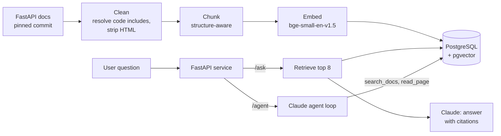

# FastAPI Docs Assistant

A retrieval-augmented generation (RAG) assistant and tool-using agent that answers questions about the [FastAPI](https://fastapi.tiangolo.com/) web framework from its official documentation, with cited sources.

I built every component from scratch, then measured it: data cleaning, chunking, embeddings, vector search, LLM generation, an agent, automated tests, and an evaluation framework. Every configuration choice is backed by a documented experiment.


## Highlights

- **Tool-using agent**: 100% fully correct answers on 40 in-scope evaluation questions (two runs), versus about 91% for plain RAG, at about 2.2x the input tokens.
- **No hallucinated answers to out-of-scope questions**: every out-of-scope question was refused, in every run, by both plain RAG and the agent.
- **Evaluation framework**: a hand-verified 45-question dataset; retrieval metrics (hit@k, recall@k, MRR); LLM-as-judge grading of correctness and faithfulness plus code-based checks; repeated runs to measure variance; and a judge validated against manual review.
- **Evidence-based decisions**: page filters, k=8, and no reranker were all chosen by experiment, including experiments that didn't work.
- **CI with a quality gate**: tests run on every push, and a second workflow rebuilds the whole index from pinned data and fails if retrieval quality drops (hit@5 < 0.90).

## How it works



1. **Data**: the English FastAPI docs and the code examples they include, downloaded at a pinned commit so results are reproducible.
2. **Cleaning**: resolves code-include directives (459 code examples pulled in), turns admonitions into plain text, and strips website-only HTML, including coloring markup inside terminal-output blocks.
3. **Chunking**: splits at headings, never inside code blocks, and adds a heading breadcrumb plus a link to the exact section, so citations point to the right place.
4. **Embedding and storage**: an open-source embedding model running locally, with vectors in PostgreSQL + pgvector (HNSW index, metadata filters).
5. **Answering**: plain RAG (`/ask`) retrieves 8 chunks and asks Claude to answer only from them, with citations. The agent (`/agent`) lets Claude search and read pages itself, rephrasing when results are poor.

## Results

### Retrieval (40 in-scope questions)

| Configuration | hit@1 | hit@3 | hit@5 | recall@5 | MRR |
|---|---|---|---|---|---|
| Baseline | 0.750 | 0.875 | 0.950 | 0.912 | 0.825 |
| Exclude release notes | 0.750 | 0.900 | 0.950 | 0.912 | 0.832 |
| **+ exclude reference pages (final)** | **0.750** | **0.925** | **0.950** | **0.912** | **0.834** |
| + cross-encoder reranking | 0.700 | 0.925 | 0.950 | 0.938 | 0.820 |

Reranking rescued hard questions but was 13x slower with the same hit@5, so it wasn't adopted.

### Answer quality: plain RAG (3 runs each, mean and range)

| | k=5 | k=8 (adopted) |
|---|---|---|
| Fully correct | 0.883 (0.875-0.900) | 0.908 (0.900-0.925) |
| Faithful | 0.833 (0.800-0.875) | 0.817 (0.750-0.850) |
| False refusals | 1.67 | 0.67 |

A single run suggested k=8 was 5 points better; repeated runs showed the real gain was about half that.

### Agent vs plain RAG

| | Plain RAG (k=8) | Agent (2 runs) |
|---|---|---|
| Fully correct | 0.908 | 1.000, 1.000 |
| Faithful | 0.817 | 0.850, 0.700 |
| Out-of-scope refused | 5/5 | 5/5 |
| Avg tool calls | 1 (fixed) | 1.6 |
| Avg input tokens | ~3,200 (estimated) | ~7,000 (measured) |
| Avg seconds | ~3 | ~4 |

The agent fixed every question plain RAG failed: vocabulary mismatches (users saying "JSON data in a POST request" when the docs say "request body") and cases where retrieval found the right page but not the right part of it. Faithfulness didn't improve.

### Framework comparison: LlamaIndex

The retrieval pipeline rebuilt with LlamaIndex (same documents, embedding model, and database) in about 45 lines instead of 338. Its Markdown splitter matched hit@5 (0.950) and ranked better (MRR 0.896 vs 0.834), while its default chunk size (1,024 tokens) exceeded the embedding model's 512-token limit for most chunks (my own chunking exceeds it for 22%, mostly long code examples). Details in [NOTES.md](NOTES.md).

## Key decisions and lessons

- **Look at the data.** Inspecting cleaned output revealed code examples stored in separate files and HTML hidden in terminal-output blocks; both would have degraded the assistant silently.
- **Measure retrieval and generation separately.** Page-level retrieval metrics missed the "right page, wrong chunk" failures that answer evaluation revealed.
- **Account for variance.** The same configuration scored 80% to 87.5% faithful across runs, so decisions rely on repeated runs and on the more stable metrics.
- **Choose the metric that matches the use.** The LLM reads all top-k chunks, so hit@5 matters more here than hit@1 or MRR.
- **Re-test early decisions.** Merging small sections was decided from size statistics before evaluation existed; re-testing showed a small retrieval cost.
- **Avoid overfitting to the eval set.** Prompts contain no hints targeting specific evaluation questions, and labels were only changed when the question justified it.

## API

| Endpoint | Description |
|---|---|
| `GET /health` | Service and database status |
| `POST /search` | Most relevant documentation sections, no answer |
| `POST /ask` | Plain RAG answer with cited sources (fast, cheaper) |
| `POST /agent` | Agent answer with sources, tool-call trace, and token usage (more accurate) |

```bash
curl -X POST http://127.0.0.1:8000/ask \
  -H "Content-Type: application/json" \
  -d '{"question": "How can I make a parameter optional?"}'
```

## Getting started

Requirements: Python 3.11, conda, and an [Anthropic API key](https://platform.claude.com/) for answering.

```bash
# Environment and dependencies (versions pinned by the lock file)
conda create -n docs-assistant python=3.11 -y
conda activate docs-assistant
pip install -e ".[dev]" -c requirements-lock.txt

# PostgreSQL with pgvector
conda install -c conda-forge postgresql pgvector -y
initdb -D ~/pgdata/docs-assistant -E UTF8 --locale=C
pg_ctl -D ~/pgdata/docs-assistant -l ~/pgdata/docs-assistant.log start
createdb docs_assistant

# API key
cp .env.example .env    # then add your key

# Build the index
bash scripts/download_data.sh
python -m docs_assistant.clean
python -m docs_assistant.chunk
python -m docs_assistant.embed
python -m docs_assistant.index

# Run the API (interactive docs at http://127.0.0.1:8000/docs)
fastapi dev src/docs_assistant/api.py
```

### Tests and evaluations

```bash
pytest                                       # unit and API tests (no API key or database needed)
pytest -m integration                        # real database and embedding model
python -m docs_assistant.eval_retrieval      # retrieval metrics (free)
python -m docs_assistant.eval_answers        # answer quality with an LLM judge (uses the API)
python -m docs_assistant.eval_answers --mode agent
```

## Project structure

```
src/docs_assistant/
├── clean.py, chunk.py, embed.py, index.py   # data pipeline
├── retrieve.py, rerank.py, generate.py      # RAG
├── agent.py                                 # tool-using agent
├── api.py                                   # FastAPI service
├── eval_data.py, eval_retrieval.py, eval_answers.py   # evaluation
└── llamaindex_version.py                    # framework comparison
evals/questions.jsonl                        # evaluation dataset
evals/results/                               # saved evaluation runs
tests/                                       # unit, API, and integration tests
.github/workflows/                           # CI: tests and retrieval quality gate
NOTES.md                                     # detailed lab notebook of every decision
```

## Limitations and future work

- The evaluation set has 40 in-scope questions, so a difference of one question is 2.5 points; the agent now scores 100%, so harder, multi-part questions are needed.
- The LLM judge agreed with my manual review on 8 of 10 answers; refining its rubric would make judge-based metrics more reliable.
- 234 of 1,059 chunks (22%) exceed the embedding model's 512-token limit, mostly long code examples, so their endings are invisible to search (the LLM still receives the full text). Chunking by token count instead of word count, or a longer-context embedding model, would fix this.
- Plain RAG's token usage was estimated rather than measured.
- Promising leads not yet adopted, since they need answer evaluation: LlamaIndex-style chunking and a larger reranker.

## Tech stack

Python, FastAPI, PostgreSQL + pgvector, sentence-transformers (BAAI/bge-small-en-v1.5), Anthropic Claude (Haiku for answers, Sonnet as judge), LlamaIndex, pytest, GitHub Actions.

## Acknowledgments

Documentation content from [FastAPI](https://github.com/fastapi/fastapi) (MIT license). Downloaded by script, not redistributed in this repository.

